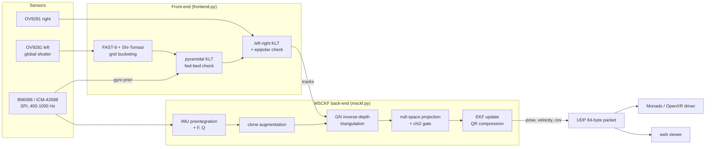

# insight-vio

**Inside-out 6DoF tracking for a DIY VR headset.** Two global-shutter cameras plus an IMU
on a Raspberry Pi 5 or Jetson Orin Nano, and the headset tracks itself in space with no
base stations or lighthouses. insight-vio is a stereo **visual-inertial odometry** stack
built around a hand-written **MSCKF** (Multi-State Constraint Kalman Filter), the same
filter family behind Google Tango and many open-source headset trackers.

Everything that does the estimation is written from scratch in numpy, and the code is laid
out so it can be ported to C++ module by module:

* Lie-group maths (SO(3)/SE(3) exp/log, Jacobians, Hamilton quaternions, JPL conversion)
* FAST-9 corner detector with Shi-Tomasi scoring, NMS and grid bucketing
* pyramidal Lucas-Kanade (KLT) optical flow with forward-backward checking and gyro-aided prediction
* on-manifold IMU preintegration (Forster et al.) with bias Jacobians and covariance
* MSCKF with a sliding window of camera clones, Gauss-Newton inverse-depth triangulation,
  null-space projection, chi-squared gating, QR measurement compression and stereo
* configurable IMU-camera extrinsics and time offset, Kalibr import
* synthetic head-motion simulator (IMU + landmarks + a ray-cast image renderer), EuRoC
  loader, and ATE/RPE evaluation
* hardware layer: BMI088 / ICM-42688 SPI drivers, picamera2 / GStreamer camera sources,
  time-sync tools, a UDP pose protocol, OpenXR/Monado notes and a web trajectory viewer

OpenCV is used only for camera I/O and PNG decoding. It is not used for any of the VIO maths.

> **Honest status:** the algorithms are implemented and tested on synthetic data on a
> desktop PC (numbers below). The pipeline has **not yet been run on EuRoC or on real
> headset hardware**, and the Python implementation is **not real-time** on a Pi 5 (about
> 0.45 s per stereo frame on a desktop CPU). Real-time use needs the planned C++ port. See
> [Hardware validation / TODO](#hardware-validation--todo-for-the-author).

<!-- demo video here: headset walking a loop in a room, live trajectory in the web viewer -->

---

## Architecture



```
insight_vio/
  lie.py            SO(3)/SE(3), Jacobians, Hamilton/JPL quaternions
  imu.py            noise model, Forster preintegration, ZOH segment iterator
  camera.py         pinhole + radtan / equidistant, hand-written undistortion
  features.py       FAST-9, Sobel, Shi-Tomasi, NMS, grid bucketing
  klt.py            Gaussian pyramid, bilinear sampling, pyramidal LK
  frontend.py       stereo tracker -> {feature_id: [(cam, xy_normalized)]}
  triangulation.py  linear + Gauss-Newton inverse-depth triangulation
  msckf.py          the filter
  stats.py          chi-squared quantiles (no SciPy)
  sim.py, render.py synthetic head motion, IMU, landmarks, ray-cast stereo images
  metrics.py        Umeyama, ATE, RPE, TUM I/O
  euroc.py          EuRoC ASL loader
  config.py         YAML config, Kalibr conversion
  system.py         IMU buffer + front-end + filter + static init
  udp.py            pose packet, OpenXR axes
  viewer.py         self-contained HTML/canvas 3D viewer + live UDP viewer
  hw/               imu_spi.py (BMI088, ICM-42688), cameras.py, timesync.py
scripts/            run_synthetic, run_euroc, evaluate, download_euroc.sh, bench,
                    kalibr_to_config, run_live, live_viewer, view_trajectory
configs/            euroc, synthetic, pi5_ov9281_bmi088, jetson_orin_icm42688
docs/               msckf.md (full derivation), hardware.md, calibration.md,
                    udp_protocol.md, openxr_monado.md, cpp_port.md
```

## How it works

The full derivation, matching the code line by line, is in [docs/msckf.md](docs/msckf.md).
Summary:

**State.** The IMU state `R_wb, p_wb, v_wb, b_g, b_a` plus N clones `(R_i, p_i)` of past
IMU poses, one per camera frame (window N = 11). The error state has `15 + 6N` dimensions.
Rotations use a right/local perturbation `R = R̂ Exp(δθ)`. Quaternions are Hamilton,
`[w, x, y, z]`, matching Eigen, ROS, OpenXR and EuRoC. The MSCKF papers use JPL, and
`lie.jpl_to_hamilton` documents how to convert.

**Propagation.** IMU samples between two images are preintegrated:

```
ΔR = Π Exp((ω_k − b_g) dt)
Δv = Σ ΔR_k (a_k − b_a) dt
Δp = Σ Δv_k dt + ½ ΔR_k (a_k − b_a) dt²
```

The prediction is then

```
R_j = R_i ΔR
v_j = v_i + g T + R_i Δv
p_j = p_i + v_i T + ½ g T² + R_i Δp
```

The error-state transition `F` comes analytically from the preintegrated deltas and their
bias Jacobians, e.g. `δθ_j = ΔRᵀ δθ_i + J^R_g δb_g` and
`δv_j = δv_i − R_i[Δv]× δθ_i + R_i(J^v_g δb_g + J^v_a δb_a)`. `Q` is the preintegration
covariance rotated into the world frame plus the bias random walk. The covariance updates
as `P_II ← F P_II Fᵀ + Q` and `P_IC ← F P_IC`.

**Augmentation.** Each new image appends a clone of the current pose:
`P ← [[P, PJᵀ], [JP, JPJᵀ]]`.

**Measurement.** A feature seen by clone `(R, p)` in camera `k`:
`p_c = R_bcᵀ(Rᵀ(p_f − p) − p_bc)`, `z = p_c[:2]/p_c[2] + n`, with
`∂z/∂δθ = J_π R_bcᵀ [p_b]×` and `∂z/∂δp = −J_π R_bcᵀ Rᵀ`. Stereo adds rows from the
right camera through its own extrinsic, so mono and stereo share one code path.

**Update.** When a track ends, or its oldest clone is about to leave the window, the
filter:

1. triangulates the feature with Levenberg-Marquardt on the anchor inverse depth `(α, β, ρ)`;
2. stacks `r = H_x δx + H_f δp_f + n`;
3. projects onto the left null space `A` of `H_f` (QR), so `r_o = Aᵀr = AᵀH_x δx + n_o`
   no longer depends on the unknown feature error;
4. gates each feature with `r_oᵀ (H_o P H_oᵀ + σ²I)⁻¹ r_o < χ²_0.95(dof)`;
5. compresses the stacked system with QR and runs the EKF update in Joseph form.

**Time offset and extrinsics.** `t_imu = t_cam + time_offset` (Kalibr's convention) is
applied to every image. Camera-to-IMU transforms come from the config or Kalibr. Both are
fixed parameters for now, and online estimation is on the roadmap.

## Quick start

```bash
pip install numpy pyyaml pytest            # core; add opencv-python-headless for EuRoC PNGs
python -m pytest -v                        # all tests (~2-3 min, includes end-to-end VIO)
python scripts/run_synthetic.py --duration 30 --out results/synthetic   # writes trajectory.html
python scripts/run_synthetic.py --duration 5 --images                  # full image pipeline
python scripts/bench.py                    # per-stage timings on your machine
```

To stream poses to a runtime or viewer without hardware:

```bash
python scripts/live_viewer.py &            # http://localhost:8080
python examples/stream_synthetic.py --duration 30
python examples/udp_receiver.py            # what a Monado driver would see
```

### EuRoC

```bash
scripts/download_euroc.sh MH_01_easy V1_01_easy      # several GB, not run in CI
pip install opencv-python-headless                   # PNG decoding only
python scripts/run_euroc.py data/euroc/MH_01_easy --out results/MH_01.txt
python scripts/evaluate.py results/MH_01.txt data/euroc/MH_01_easy
python scripts/view_trajectory.py results/MH_01.txt --align -o results/MH_01.html
```

`run_euroc.py` initialises from ground truth by default, which isolates tracking
quality. `--static-init` uses gravity alignment from a stationary IMU window instead.

## Results

### Measured here (synthetic data, Windows 10, AMD Ryzen 5 3600, Python 3.12, numpy 2.x)

All runs use the simulated head trajectory: ±0.75 m sway, ±70° yaw, ±20° pitch and roll
nods, inside an 8 × 8 × 3 m textured room. The IMU runs at 200 Hz with EuRoC/ADIS16448
noise and bias random walk. Initial biases are drawn at σ = 0.01 rad/s and 0.05 m/s², and
the filter starts from a zero bias estimate. Cameras run at 20 Hz, 640×480, f = 400 px,
with a 6.4 cm baseline. ATE is the translation RMSE after SE(3) Umeyama alignment.

| run | input | ATE RMSE | ATE max | RPE (1 s) |
|---|---|---:|---:|---:|
| stereo, 30 s | simulated tracks, 0.5 px noise | **0.50 cm** | 0.84 cm | 0.32 cm / 0.047° |
| stereo, 60 s, seed 3 | simulated tracks, 0.5 px noise | **0.60 cm** | 1.47 cm | 0.34 cm / 0.047° |
| mono, 30 s | simulated tracks, 0.5 px noise | **0.93 cm** | 2.10 cm | 0.68 cm / 0.074° |
| stereo, 30 s | simulated tracks, 1.5 px noise (filter σ = 3 px) | **1.34 cm** | 2.21 cm | 0.75 cm / 0.098° |
| stereo, 20 s | **ray-cast images → FAST/KLT front-end → MSCKF** | **0.45 cm** | 0.92 cm | - |
| IMU only (dead reckoning), 30 s | same IMU data | 25.9 m | | |

A tuning lesson from the runs above: with 1.5 px true noise but the filter set to
σ = 1 px, ATE grew to 7.5 cm. An over-confident filter hurts more than a conservative one.

These are synthetic numbers. They check that the maths and the code are correct, and they
say little about real-world accuracy: the simulation has no motion blur, no rolling
shutter, no lighting changes, perfect calibration and perfect time sync. Real systems on
EuRoC typically reach 5-20 cm ATE.

The CI tests assert the following on synthetic data: stereo ATE < 3 cm over 20 s (0.36 cm
measured), mono < 5 cm (0.77 cm measured), image pipeline < 3 cm over 3 s (0.31 cm
measured), injected outliers rejected, and propagation and measurement Jacobians matching
finite differences.

### Timing (same machine, Python; `scripts/bench.py`)

| stage | ms |
|---|---:|
| FAST + Shi-Tomasi, 640×480 | 118 |
| image pyramid, 4 levels | 21 |
| KLT, 120 points | 115 |
| stereo front-end per frame (temporal + stereo KLT, detection) | 400 |
| MSCKF back-end per frame (120 tracks, 11 clones) | 60-75 |

**Real-time feasibility.** A 30 Hz headset has a budget of 33 ms per frame. The Python
version is about 15× too slow even on a desktop, and a Pi 5 will be slower again. Use the
Python version for development, recording and offline replay. [docs/cpp_port.md](docs/cpp_port.md)
lays out the C++/NEON port; comparable C++ MSCKF implementations run in a few
milliseconds per frame.

### EuRoC (to be filled in by the author; not run yet)

| sequence | ATE RMSE (m) | RPE 1 s (m / deg) | ms/frame | machine |
|---|---:|---:|---:|---|
| MH_01_easy | | | | |
| MH_03_medium | | | | |
| MH_05_difficult | | | | |
| V1_01_easy | | | | |
| V1_02_medium | | | | |
| V2_01_easy | | | | |

## Hardware validation / TODO for the author

None of the following has been done. Each item has the exact commands to run.

1. **EuRoC.** Fill in the table above:
   ```bash
   scripts/download_euroc.sh MH_01_easy MH_03_medium MH_05_difficult V1_01_easy V1_02_medium V2_01_easy
   for s in MH_01_easy MH_03_medium MH_05_difficult V1_01_easy V1_02_medium V2_01_easy; do
     python scripts/run_euroc.py data/euroc/$s --out results/$s.txt
     python scripts/evaluate.py results/$s.txt data/euroc/$s
   done
   ```
   Expect to tune `frontend.fast_threshold`, `filter.pixel_sigma` and possibly add 2-point
   RANSAC (roadmap) on the harder sequences.
2. **Build the sensor head.** Follow [docs/hardware.md](docs/hardware.md) (Pi 5 + 2× OV9281
   + BMI088, or Jetson Orin Nano + ICM-42688).
3. **Check that the IMU driver reads sane values.** Gravity should be ≈ 9.81 m/s² at
   rest, and a 90° turn should integrate to ≈ 90°:
   ```bash
   python -c "from insight_vio.hw.imu_spi import *; i=BMI088(SpidevBus(0,0),SpidevBus(0,1)); i.configure(); print(i.read())"
   ```
4. **Calibrate with Kalibr.** Follow [docs/calibration.md](docs/calibration.md), then
   run `scripts/kalibr_to_config.py`.
5. **Record and replay a session.**
   ```bash
   python scripts/run_live.py --config configs/my_headset.yaml --record ~/sessions/loop1
   python scripts/run_euroc.py ~/sessions/loop1 --static-init --out results/loop1.txt
   ```

   | session | length (m) | loop-closure end-point error (m) | % of length | notes |
   |---|---:|---:|---:|---|
   | | | | | |

6. **Measure live latency and rate on the Pi 5 / Jetson.**

   | platform | front-end ms | back-end ms | total ms | Hz achieved |
   |---|---:|---:|---:|---:|
   | Pi 5 (Python) | | | | |
   | Jetson Orin Nano (Python) | | | | |

7. **Integrate with Monado.** See [docs/openxr_monado.md](docs/openxr_monado.md).

<!-- video here: side-by-side headset view and live_viewer trajectory -->

## Roadmap

- [ ] EuRoC numbers (see above)
- [ ] 2-point RANSAC with the gyro rotation prior in the front-end
- [ ] online extrinsic and time-offset estimation (Li & Mourikis)
- [ ] first-estimate Jacobians / OC-EKF for yaw consistency
- [ ] SLAM features (long-lived landmarks in the state) and zero-velocity updates
- [ ] IMU-rate pose output (500 Hz) for low-latency rendering
- [ ] C++17 + Eigen port with pybind11 bindings and golden tests ([plan](docs/cpp_port.md))
- [ ] Monado driver
- [ ] hardware validation on Pi 5 and Jetson Orin Nano

## References

* A. I. Mourikis, S. I. Roumeliotis, *A Multi-State Constraint Kalman Filter for
  Vision-aided Inertial Navigation*, ICRA 2007.
* C. Forster, L. Carlone, F. Dellaert, D. Scaramuzza, *On-Manifold Preintegration for
  Real-Time Visual-Inertial Odometry*, T-RO 2017.
* N. Trawny, S. I. Roumeliotis, *Indirect Kalman Filter for 3D Attitude Estimation*
  (JPL quaternions), 2005.
* E. Rosten, T. Drummond, *Machine learning for high-speed corner detection*, ECCV 2006.
* J. Shi, C. Tomasi, *Good Features to Track*, CVPR 1994; J.-Y. Bouguet, *Pyramidal
  Implementation of the Lucas Kanade Feature Tracker*, 2000.
* S. Umeyama, *Least-squares estimation of transformation parameters between two point
  patterns*, PAMI 1991.
* M. Burri et al., *The EuRoC micro aerial vehicle datasets*, IJRR 2016.

## License

MIT. See [LICENSE](LICENSE).
